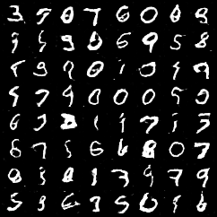

# SPS Generative AI API

This FastAPI project provides six endpoints:

- `POST /generate` generates text with a simple bigram model.
- `POST /embedding` returns the 300-dimensional `en_core_web_lg` spaCy
  embedding for a query word.
- `POST /classify` classifies an uploaded image as one of the ten CIFAR-10
  classes.
- `POST /generate-image` generates a 28 x 28 grayscale handwritten digit with a GAN.
- `POST /generate-diffusion` generates a 32 x 32 RGB image using a diffusion model.
- `POST /generate-ebm` generates a 32 x 32 RGB image using an energy-based model.

## Local setup

```bash
uv sync
uv run fastapi dev main.py
```

Open the interactive API documentation at <http://127.0.0.1:8000/docs>.

Example embedding request:

```bash
curl -X POST http://127.0.0.1:8000/embedding \
  -H 'Content-Type: application/json' \
  -d '{"query_word":"apple"}'
```

The response contains the normalized query, vector dimension, and full vector:

```json
{
  "query_word": "apple",
  "dimension": 300,
  "embedding": [-0.36391, 0.43771, -0.20447]
}
```

The example above abbreviates the vector; the API returns all 300 values.

## Docker

```bash
docker build -t sps-genai-assignment3 .
docker run --rm -p 8000:80 sps-genai-assignment3
```

Then open <http://127.0.0.1:8000/docs> or query the endpoint with `curl`.

## Assignment 2: CIFAR-10 CNN

### Assignment 2 code map

- `app/cifar10_model.py`: required CNN architecture and shared image preprocessing.
- `train_cifar10.py`: CIFAR-10 loading, training, evaluation, and checkpoint saving.
- `app/cifar10_classifier.py`: checkpoint loading and image inference logic.
- `main.py`: FastAPI `POST /classify` endpoint.
- `artifacts/cifar10_cnn.pt`: trained model checkpoint.
- `Dockerfile`: deployable FastAPI image containing the trained model.
- `pyproject.toml` and `uv.lock`: Python and CPU-only Docker dependencies.

The main implementation was added in commit `cb5a2f8` (`Add CIFAR-10 CNN
classifier and API endpoint`).

The Assignment 2 model follows the required 64 x 64 architecture:

```text
3 x 64 x 64
-> Conv2d(3, 16, 3, padding=1) -> ReLU -> MaxPool2d(2)
-> Conv2d(16, 32, 3, padding=1) -> ReLU -> MaxPool2d(2)
-> Flatten -> Linear(8192, 100) -> ReLU -> Linear(100, 10)
```

Train and evaluate the classifier on CIFAR-10:

```bash
uv run python train_cifar10.py --epochs 10 --batch-size 256
```

The training script resizes CIFAR-10 images to 64 x 64 and saves the trained
checkpoint to `artifacts/cifar10_cnn.pt`.

The committed checkpoint was trained for 10 epochs and achieved **60.27% test
accuracy** on all 10,000 CIFAR-10 test images after being reloaded from disk.

After training, start the API and classify an image:

```bash
uv run fastapi dev main.py
curl -X POST http://127.0.0.1:8000/classify \
  -F 'image=@example.png'
```

The response contains the predicted class, class index, confidence, and the
probability assigned to every CIFAR-10 class.

Example response:

```json
{
  "predicted_class": "cat",
  "class_index": 3,
  "confidence": 0.6251,
  "probabilities": {
    "airplane": 0.0003,
    "automobile": 0.0001,
    "bird": 0.1253,
    "cat": 0.6251,
    "deer": 0.0485,
    "dog": 0.1942,
    "frog": 0.0001,
    "horse": 0.0062,
    "ship": 0.0001,
    "truck": 0.0001
  }
}
```

To verify the pipeline quickly before a full training run:

```bash
uv run python train_cifar10.py \
  --epochs 1 \
  --max-train-batches 2 \
  --max-test-batches 2 \
  --checkpoint /tmp/cifar10_cnn_smoke.pt
```

## Assignment 3: MNIST GAN

### Code map

- `app/mnist_gan.py`: the Generator and Discriminator from Part 1.
- `train_mnist_gan.py`: MNIST preprocessing, alternating training, and saved weights.
- `app/mnist_generator.py`: loads the trained Generator and converts its output to PNG.
- `main.py`: the `POST /generate-image` endpoint.
- `artifacts/mnist_generator.pt`: trained Generator weights and training settings.
- `artifacts/mnist_gan_samples.png`: 64 generated images from fixed noise vectors.
- `artifacts/mnist_gan_training.csv`: losses recorded during training.
- `assignment3_answers.txt`: worked answers to Part 3.

The Generator uses the required layers:

```text
100 noise values
-> Linear(100, 6272) -> reshape to 128 x 7 x 7
-> ConvTranspose2d(128, 64, 4, stride=2, padding=1) -> BatchNorm2d -> ReLU
-> ConvTranspose2d(64, 1, 4, stride=2, padding=1) -> Tanh
-> 1 x 28 x 28 image
```

The Discriminator uses:

```text
1 x 28 x 28 image
-> Conv2d(1, 64, 4, stride=2, padding=1) -> LeakyReLU(0.2)
-> Conv2d(64, 128, 4, stride=2, padding=1) -> BatchNorm2d -> LeakyReLU(0.2)
-> Flatten -> Linear(6272, 1) -> Sigmoid
```

Sigmoid gives the real/fake probability used by binary cross-entropy loss.
MNIST pixels are normalized to [-1, 1] to match the Generator's Tanh output.
The Discriminator learns from real images labeled 1 and generated images labeled 0.
The Generator is then updated with target 1 while the Discriminator's weights are fixed.

Train the model:

```bash
uv run python train_mnist_gan.py --epochs 20 --batch-size 128 --seed 42
```

The saved Generator was trained for 20 epochs on all 60,000 MNIST training
images, using batch size 128, learning rate 0.0002, and seed 42.
The recorded losses are in `artifacts/mnist_gan_training.csv`.



Training selects CUDA, Apple MPS, or CPU, depending on availability. To choose
one explicitly, add `--device cpu`, `--device mps`, or `--device cuda`.
The API uses CPU inference and the saved checkpoint, so it does not train on startup.

After starting the API locally or with Docker, generate an image:

```bash
curl -X POST http://127.0.0.1:8000/generate-image \
  -H 'Content-Type: application/json' \
  -d '{"seed":42}' \
  --output digit.png
```

The response is a PNG image. Repeat a seed to reproduce an image, or send `{}`
for a random one. This is an unconditional GAN, so a request does not select
a particular digit. Generated images vary in quality.

## Assignment 4: CIFAR-10 image generation

Both generators train on the native 32 x 32 RGB CIFAR-10 training images with
pixel values scaled to [-1, 1]. Both are unconditional generators.

- `app/cifar10_diffusion.py` adds noise according to the Module 8 offset
  cosine schedule and trains a time-conditioned U-Net with L1 noise prediction
  loss. To generate an image, it runs the schedule backward from Gaussian noise.
- `app/cifar10_ebm.py` scores each image with one scalar energy. Langevin
  sampling differentiates that energy with respect to image pixels and updates
  the pixels to seek lower energy.
- `train_cifar10_generators.py` trains either model. For the EBM, a replay buffer
  supplies starting points for negative samples. The weight update reduces
  energies on real images relative to the sampled negatives.
- `app/cifar10_image_generator.py` loads the trained weights on the CPU and
  converts samples to PNG. `main.py` exposes both generators through FastAPI.

Train the models and save their weights to `artifacts/cifar10_diffusion.pt`
and `artifacts/cifar10_ebm.pt`:

```bash
uv run python train_cifar10_generators.py diffusion --epochs 3
uv run python train_cifar10_generators.py ebm --epochs 2
```

The included checkpoints use all 50,000 training images per epoch, batch size
128, and seed 42. The EBM uses eight Langevin steps per training batch and
128 steps to generate an API sample.

After training, start the API with `uv run fastapi dev main.py` and request images:

```bash
curl --fail -X POST http://127.0.0.1:8000/generate-diffusion \
  -H 'Content-Type: application/json' -d '{"seed":42}' --output diffusion.png
curl --fail -X POST http://127.0.0.1:8000/generate-ebm \
  -H 'Content-Type: application/json' -d '{"seed":42}' --output ebm.png
```

Both endpoints return one PNG image. A repeated seed reproduces a sample
with the same weights. Use `{}` for a random seed. If a model checkpoint is
missing, its endpoint returns HTTP 503.
